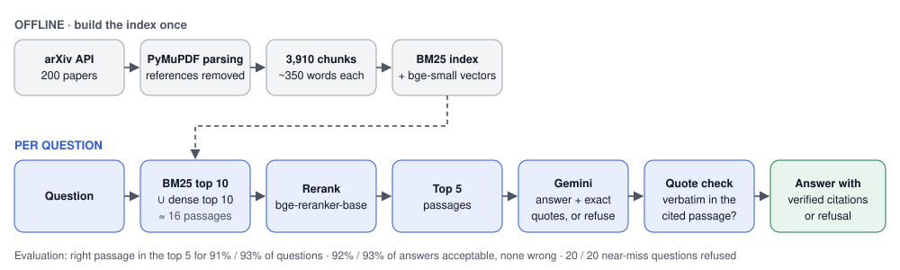
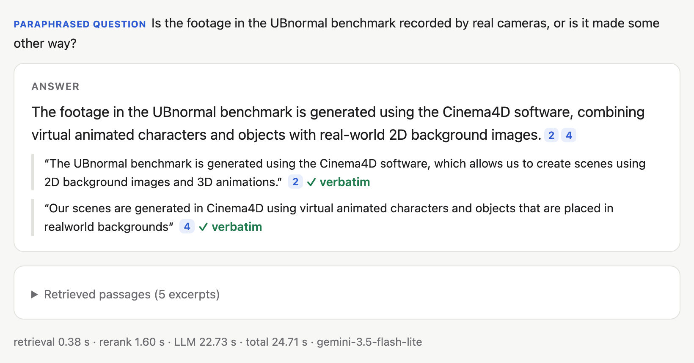
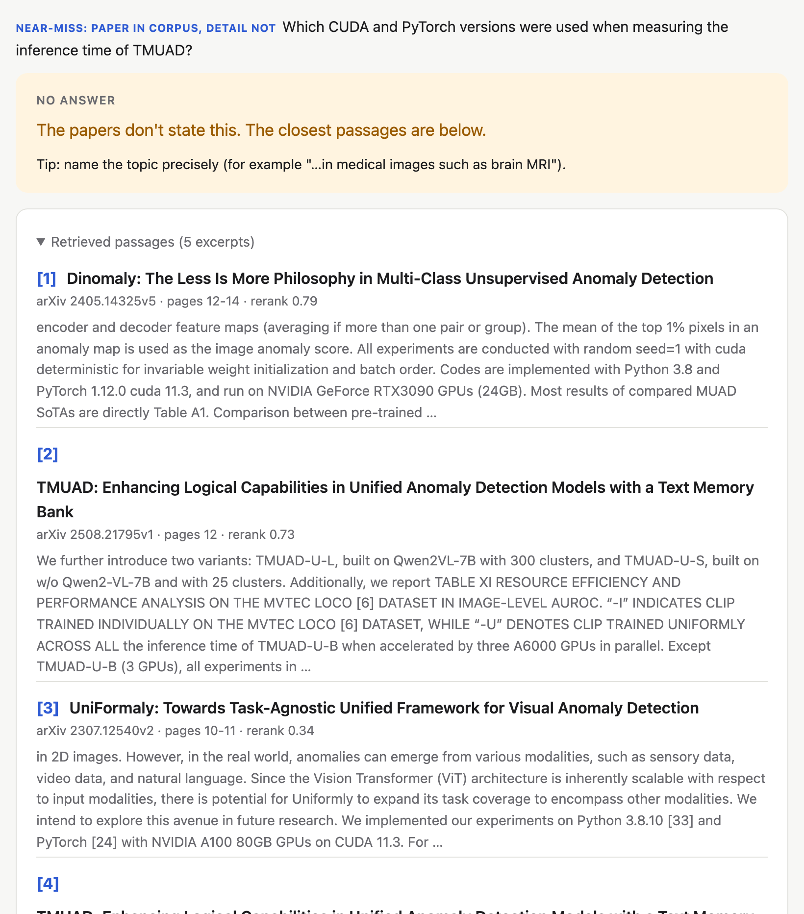

# ScholarRAG

**Question answering over 200 arXiv papers on visual anomaly detection. Every answer cites the passage it comes from, the quote is checked against the source, and when the papers don't contain the answer, the system says so.**

**▶ [Recorded demo](https://huggingface.co/spaces/peanut2butter9/scholarrag)** (replays real answers; no setup) · **Live system:** on request, through a temporary link ([contact](https://peanut2butter9.github.io)) · **Author:** Moh Hasbi Alfarizi



## At a glance

| Part | What |
|---|---|
| Corpus | 200 arXiv papers on visual anomaly detection, split into 3,910 passages |
| Retrieval | BM25 ∪ dense (`bge-small-en-v1.5`), reranked by `bge-reranker-base`; best 5 passages |
| Answering | Gemini (`gemini-3.5-flash-lite`) answers in JSON with an exact quote per citation, or refuses; every quote is verified in code |
| App | FastAPI + a dependency-free web UI, rate limits, tests, and a static demo on Hugging Face Spaces |

| Result (details below) | Value |
|---|---|
| Right passage among the 5 retrieved (LLM-written / handwritten questions) | 0.91 / 0.93 |
| Paraphrased questions: right passage ranked first, vs BM25 alone | 0.73 vs 0.20 |
| Acceptable answers, LLM judge checked on a manual sample (64 / 15 questions) | 0.92 / 0.93, **none wrong** |
| Near-miss questions refused (paper in the corpus, detail not) | **20 / 20** |
| Median time per question on a laptop | ≈ 3 s (Gemini speed varies) |

<p>
  
  
</p>

*Left: a paraphrased question answered with two verified quotes. Right: a near-miss question refused even though the retrieved passages mention CUDA and PyTorch versions, because those belong to other papers.*

**Worth a closer look**

- **Evaluation first.** Two frozen question sets (64 LLM-written, 15 handwritten) and 20 near-miss questions were built before any tuning; every change is measured against them.
- **Question wording matters.** BM25 wins on LLM-written questions because they reuse the passage's words; on paraphrased questions dense retrieval wins (Hit@1 0.60 vs 0.20), and the reranked hybrid reaches 0.73.
- **Grounding is checked, not assumed.** A quote that is not verbatim in the cited passage is flagged in the UI; the recorded demo shows one case where Gemini dropped a parenthesis.
- **Honest negatives.** Smaller chunks, RRF alone, a MiniLM reranker and query rewriting by default were all tested and rejected, with the numbers in the notebooks.
- **The judge was checked too.** It agrees with a human rater on 19 of 25 sampled answers and is stricter about completeness, so 0.92 is the strict figure.

**Run it locally:** create the environment and `.env` (see [Running](#running)), then `.venv/bin/uvicorn app:app --app-dir src --port 8000` and open <http://localhost:8000>.

**Repository map:** `ScholarRAG_local.ipynb` (corpus, chunking, question sets, baselines) → `02`–`06` notebooks (chunk size, hybrid + rerank, answers, evaluation, query rewriting) · `src/` (pipeline `rag.py`, API `app.py`, UI) · `scripts/` (demo recording, screenshots, Space build) · `tests/` · `deploy/` (Dockerfile, demo recordings).

---

## Status

| Milestone | What | Status |
|---|---|---|
| M0 | Corpus collection and question sets | ✅ corpus · ✅ LLM questions frozen · ✅ handwritten questions frozen |
| M1 | PDF parsing and chunking | ✅ |
| M2 | Baseline retrieval (dense vs BM25) + metrics | ✅ |
| – | Chunk-size experiment (350 / 250 / 180 words) | ✅ keep 350 words |
| M3 | Hybrid search (RRF) + cross-encoder reranker | ✅ BM25 ∪ dense top 10 → `bge-reranker-base` (level with BM25 on set A, far ahead on set B1) |
| M4 | Answers with citations and refusal | ✅ Gemini, verified quotes; 20 / 20 unanswerable refused |
| M5 | Answer evaluation (citations, refusals, cost, latency) | ✅ acceptable 0.92 (A) / 0.93 (B1), 0 incorrect, no hallucinated refusals |
| M6 | FastAPI + UI, deployment | ✅ API + web UI, tests, rate limit · ✅ recorded demo on a static Space · live Space ready but needs Hugging Face PRO |

## Results so far

Baseline retrieval on the 64 frozen LLM-generated questions (`eval/questions_v1.csv`) over 3,910 indexed chunks:

| Retriever | Hit@1 | Hit@5 | Hit@10 | Hit@20 | MRR | PaperHit@10 |
|---|---|---|---|---|---|---|
| Dense (bge-small-en-v1.5) | 0.391 | 0.656 | 0.797 | 0.828 | 0.512 | 0.922 |
| BM25 | **0.625** | **0.906** | **0.938** | **0.969** | **0.751** | **1.000** |

- **Hit@k:** share of questions whose gold chunk appears in the top *k*.
- **MRR:** mean of 1 / rank of the first gold chunk (0 if not found).
- **PaperHit@10:** share of questions whose gold *paper* appears in the top 10.

BM25 wins clearly here, but the LLM-written questions reuse wording from their source passage, which favours keyword search. The handwritten question set tests that.

### Per question source

Set A plus the 15 handwritten answerable questions (set B1), same index:

| Source | Retriever | Hit@1 | Hit@10 | MRR |
|---|---|---|---|---|
| LLM (n = 64) | Dense | 0.391 | 0.797 | 0.512 |
| LLM (n = 64) | BM25 | **0.625** | **0.938** | **0.751** |
| Handwritten (n = 15) | Dense | **0.600** | 0.800 | **0.665** |
| Handwritten (n = 15) | BM25 | 0.200 | **0.933** | 0.442 |

On paraphrased questions dense puts the right chunk first far more often, while BM25 still reaches the top 10 slightly more often. Part of BM25's lead on set A therefore comes from question wording. With 15 questions one question is 6.7 points, so this is a strong hint rather than a final result, and it supports combining both retrievers (M3).

### Chunk size

Same pipeline at 350, 250 and 180 words (`02_chunk_size_experiment.ipynb`, full table in `eval/results_chunk_size.csv`):

| Size | Chunks | Over 512 tokens | Set A Dense MRR | Set A BM25 MRR | Set B1 Dense MRR | Set B1 BM25 MRR |
|---|---|---|---|---|---|---|
| 350 | 3,910 | 22.5% | **0.512** | **0.751** | **0.665** | 0.442 |
| 250 | 5,945 | 0.5% | 0.475 | 0.708 | 0.624 | 0.508 |
| 180 | 9,379 | 0.0% | 0.501 | 0.659 | 0.639 | **0.588** |

Shorter chunks remove dense truncation but do not improve dense retrieval, and BM25 gets worse on set A. BM25 improves on handwritten questions as chunks shrink, but that is 3 questions out of 15. **350 words stays the default**, and the M3 run below confirms it with a reranker too.

### Hybrid + rerank (M3)

350-word chunks; RRF over the top 100 of each retriever; cross-encoder on the fused top 20 (`03_hybrid_rerank.ipynb`, full tables in `eval/results_m3.csv`):

| Method | Set A Hit@1 | Set A MRR | Set B1 Hit@1 | Set B1 MRR | Seconds / question (M1) |
|---|---|---|---|---|---|
| BM25 | 0.625 | **0.752** | 0.200 | 0.443 | – |
| Dense | 0.391 | 0.514 | 0.600 | 0.668 | – |
| Hybrid (RRF) | 0.516 | 0.656 | 0.533 | 0.644 | – |
| Hybrid + `ms-marco-MiniLM-L-6-v2` | 0.562 | 0.689 | 0.400 | 0.510 | 0.6 |
| **Hybrid + `bge-reranker-base`** | **0.656** | 0.743 | **0.733** | **0.786** | 3.8 |

- **Hybrid + `bge-reranker-base` is the best overall.** It ties BM25 on set A (question by question: 16 better, 31 same, 17 worse) and is clearly best on handwritten questions (8 better, 1 worse than BM25). The M3 target is partly met: Hit@1 on set A is above BM25, MRR is level.
- **RRF alone hurts on set A.** Four set A questions are in BM25's top 20 (one at rank 1) but missing from dense's top 100, so RRF drops them to ranks 46–50, outside the reranker's view. The fused Hit@20 (0.906) is below BM25's (0.969) and caps the reranked scores.
- **MiniLM** (trained on web search queries) makes handwritten questions worse and is dropped.
- **Chunk size:** with `bge-reranker-base`, 86% of pairs at 350 words exceed 512 tokens (3.9% at 250), yet 350 scores the same or better, so truncation is not the bottleneck.

### Candidate-pool fix (final M3 setup)

Instead of RRF's top 20, the reranker scores the union of BM25's and dense's top *k* (`03_hybrid_rerank.ipynb` sections 7–8; `eval/results_m3_pool.csv`). Set A:

| Reranked candidates | Pairs / question | Gold in pool | Hit@1 | Hit@5 | Hit@10 | MRR |
|---|---|---|---|---|---|---|
| BM25 alone (no rerank) | – | – | 0.625 | 0.906 | 0.938 | **0.752** |
| RRF top 20 | 20 | 0.906 | **0.656** | 0.875 | 0.906 | 0.743 |
| **BM25 top 10 ∪ dense top 10** | 15.7 | 0.938 | 0.625 | **0.906** | 0.938 | 0.740 |
| BM25 top 20 ∪ dense top 20 | 32.7 | **0.969** | 0.625 | 0.891 | **0.953** | 0.742 |

On the handwritten set all three reranked variants score Hit@1 0.733 and MRR 0.78–0.79 (BM25: 0.200 / 0.443).

- **Recall goes up:** three of the four questions RRF dropped come back into the top 10.
- **Hit@1 does not:** a bigger pool also brings more near-miss chunks. Against RRF top 20, two set A questions drop from rank 1 to rank 2 and none gain rank 1.
- **Chosen setup: BM25 top 10 ∪ dense top 10 → `bge-reranker-base`.** It is cheaper than RRF top 20 (≈ 16 pairs, roughly 3 s per question on an M1), ties BM25 on set A at Hit@5 and Hit@10, and keeps the large lead on handwritten questions. The 20 + 20 pool doubles the cost (6.4 s) for no gain.

**Bottom line for M3:** on LLM-written questions the final pipeline is level with BM25 (all differences within about two questions); on paraphrased questions it is far ahead (Hit@1 0.733 vs 0.200). Since the LLM in M4 will read the top few chunks, Hit@5 is the number that matters next.

### Answers with citations and refusal (M4)

Top 5 passages from the final M3 retrieval → Gemini `gemini-3.5-flash-lite` (temperature 0, JSON schema: `answerable`, `answer`, `citations` with passage number + exact quote). Citations are verified in code (`04_answers_citations.ipynb`, per-question results in `eval/m4_results.csv`):

| Set | n | Gold (or paper) in the 5 passages | Answered | Refused | Citations verbatim | Cites a gold chunk |
|---|---|---|---|---|---|---|
| A, LLM | 64 | 0.906 | 63 | 1 | 62 / 63 | 54 / 63 |
| B1, handwritten | 15 | 0.933 | 14 | 1 | 14 / 14 | 11 / 14 |
| B2, unanswerable | 20 | 0.900 (paper) | **0** | **20** | – | – |

- **Refusal holds on the near-miss trap:** all 20 unanswerable questions are refused, although the right paper was among the passages for 18.
- **No missed answers:** every answerable question whose gold chunk was retrieved (72) was answered; the two refusals are retrieval misses.
- **Citations:** 76 of 77 quotes are verbatim (the exception rewrote `√` as LaTeX).
- **"Cites a gold chunk" undercounts correct answers.** Most of the 12 answers that cite no gold chunk are correct and cite another chunk of the same paper (often the abstract). One (q044) is grounded but incomplete instead of refused, and three differ from a gold answer that was written from a single passage. M5 therefore needs an answer-correctness judgment, not just chunk matching.
- **Cost:** ≈ 2,600 input and 120 output tokens per question; 1–3 s per LLM call, plus ≈ 3 s of reranking on an M1.

### Answer evaluation (M5)

An LLM judge (`gemini-3.5-flash`, a stronger model than the one that answers) compared every answer with the reference answer and the cited passages; a blind manual sample of 25 answers checks the judge (`05_evaluation.ipynb`, per-question verdicts in `eval/m5_results.csv`).

| Set | n | correct | correct_different | partial | incorrect | refused | Acceptable (judge) | Acceptable (manual labels on the sample) |
|---|---|---|---|---|---|---|---|---|
| A, LLM | 64 | 58 | 1 | 4 | **0** | 1 | **0.922** | 0.984 |
| B1, handwritten | 15 | 13 | 1 | 0 | **0** | 1 | **0.933** | 0.867 |

| Refusal check | n | Refused | Answered, supported | Answered, not supported |
|---|---|---|---|---|
| B2 near-miss | 20 | **20** | 0 | 0 |
| C out of corpus (LLM-generated, unreviewed) | 12 | 10 | 2 | **0** |

- **No answer is wrong.** The four `partial` answers are incomplete (one part of a two-part question, or a device type instead of the model name). The two `correct_different` answers expose narrow references (q046, h009).
- **No hallucination on unanswerable questions.** The two set C answers come from corpus papers that describe those methods in their related work.
- **Grounding:** 78 of 79 judged answers make only claims found in their quotes.
- **Judge vs human:** agreement 0.76 on acceptable-or-not and 0.96 on supported. The judge is stricter about completeness than the human rater, so read 0.922 / 0.933 as the strict figure.
- **Latency and cost (M1, free tier):** median 3.2 s end to end (rerank 1.7 s, Gemini 1.5 s), p90 7.4 s. $0 on the free tier; at paid-tier prices about $0.001 per answered question.

See [Known limitations](#known-limitations).

## How it works

### 1. Corpus
- arXiv query `cat:cs.CV AND abs:"anomaly detection"`, top 400 by relevance (metadata only).
- Filtered out duplicate titles, abstracts under 300 characters, and papers from before 2021, leaving 340 papers.
- Ranked by cosine similarity between `title + abstract` and a one-sentence topic description, then kept the top 200 (surveys capped at 5).
- K-means (k = 5) shows the corpus covers video AD, industrial image AD and surveys, multimodal RGB+3D, zero/few-shot and unified methods, and feature-embedding and autoencoder methods.
- PDF download is resumable, checks for the `%PDF` header, and waits 3 s between requests.

### 2. Parsing and chunking
| Decision | Value |
|---|---|
| Chunk size / overlap | ~350 words / 60 words |
| Boundaries | Cut at a paragraph break in the last 25% of the window when possible |
| References | Everything after a "References"/"Bibliography" heading (in the last 60% of the doc) is dropped; a second citation-pattern filter removes 81 more bibliography chunks |
| Noise | Blocks < 40 chars or < 50% letters are dropped |
| Hyphenation | Line-broken words are re-joined |

Result: 3,991 chunks, and 3,910 after bibliography removal. Each chunk keeps `paper_id`, title and page range so it can be cited.

### 3. Evaluation sets
Gold answers are stored as **`paper_id` + exact evidence quote**, not as chunk ids. Chunk ids change whenever the chunking changes, but the quote does not, so the same question set can evaluate any chunking scheme.

| Set | Size | Used for |
|---|---|---|
| A. LLM-generated (Gemini, temperature 0, quote verified verbatim) | 64 | Retrieval metrics |
| B1. Handwritten, answerable | 15 | Retrieval metrics, reported separately |
| B2. Handwritten, unanswerable ("near-miss": paper exists, detail doesn't) | 20 | Refusal testing (M4–M5) |

### 4. Retrieval
- **Dense:** `BAAI/bge-small-en-v1.5`, normalised embeddings, bge query prefix, exact matrix-product search. Embeddings are cached to `index/` and recomputed only when the chunk list changes.
- **BM25:** `rank_bm25.BM25Okapi`, lower-cased alphanumeric tokens, English stop words removed.

## Data layout

```
data/
├── papers_meta.jsonl            # 400 arXiv search results (id, title, abstract, published, pdf_url)
├── selected.jsonl               # 200 papers kept after filtering and ranking
├── raw/                         # 200 PDFs
├── chunks.jsonl                 # 3,991 chunks
├── chunks_clean.jsonl           # 3,910 chunks after removing bibliography chunks
├── chunks_{350,250,180}.jsonl   # clean chunks per size (chunk-size experiment; 350 = chunks_clean)
├── index/
│   ├── emb_bge_small.npy        # cached dense embeddings
│   ├── chunk_ids.json           # chunk order for the cache
│   └── emb_bge_small_{250,180}.npy + chunk_ids_{250,180}.json
├── _backup/                     # earlier versions of edited files
└── eval/
    ├── candidates.csv                   # 66 LLM-generated candidate questions
    ├── unanswerable_candidates.csv      # 12 LLM-generated unanswerable questions
    ├── questions_v1.csv                 # 64 frozen questions used for evaluation
    ├── questions_handwritten_v1.csv     # 15 answerable + 20 unanswerable (frozen)
    ├── results_chunk_size.csv           # chunk-size experiment scores
    ├── results_m3.csv                   # M3 scores per source, size and method
    ├── results_m3_ranks.csv             # M3 rank of the first gold chunk, per question
    ├── results_m3_pool.csv              # candidate-pool fix scores
    ├── results_m3_pool_ranks.csv        # candidate-pool fix ranks, per question
    ├── m4_contexts.jsonl                # M4: top 5 chunk ids per question (retrieval cache)
    ├── m4_answers.jsonl                 # M4: raw LLM outputs, tokens, latency (answer cache)
    ├── m4_results.csv                   # M4: automatic checks per question
    ├── m5_setC.jsonl                    # M5: answers to the 12 out-of-corpus questions
    ├── m5_latency.csv                   # M5: retrieval time per stage, 20 questions
    ├── m5_judgments.jsonl               # M5: LLM-judge verdicts (cache)
    ├── m5_results.csv                   # M5: verdict per question (after the judge finishes)
    └── m5_manual_sample.csv / m5_manual_key.csv   # M5: blind manual sample and the judge's verdicts
```

The same data is also on Google Drive at `MyDrive/scholar-rag/data/` (from the Colab period).

Frozen question files are never overwritten. Any change is saved as a new version (`questions_v2.csv`, …) so scores from different days stay comparable.

## Running

The project runs locally (VS Code, Python 3.12) from `~/Projects/scholar-rag`, outside iCloud-synced folders:

| Notebook | Contents |
|---|---|
| `ScholarRAG_local.ipynb` | Main pipeline: corpus, chunking, question sets, baseline retrieval, per-source evaluation |
| `02_chunk_size_experiment.ipynb` | Chunk-size experiment (350 / 250 / 180 words) |
| `03_hybrid_rerank.ipynb` | M3: RRF fusion and two cross-encoder rerankers at 350 and 250 words (sections 1–6), candidate-pool fix (sections 7–8). First run downloads ~1.2 GB of models; ~35 min on an M1 |
| `04_answers_citations.ipynb` | M4: retrieval → Gemini answers with citations or refusal, citation checks. Needs `GEMINI_API_KEY`; contexts and answers are cached, so a re-run does not call the LLM again |
| `05_evaluation.ipynb` | M5: out-of-corpus refusal (set C), LLM judge of answer correctness, blind manual sample, refusal accuracy, cost and latency. Resumable: stops cleanly when the judge's daily quota runs out |
| `06_query_rewriting.ipynb` | Query rewriting for broad questions: five broad questions, three retrieval variants, rewrite latency; why rewriting is opt-in |

1. **Environment:** `uv venv --python 3.12 .venv`, then `uv pip install --python .venv/bin/python -r requirements.txt`, then register the kernel with `.venv/bin/python -m ipykernel install --user --name scholar-rag`. Python 3.15 is too new for `torch`.
2. **API key:** copy `.env.example` to `.env` and fill in `GEMINI_API_KEY` (answers, the M5 judge, question generation, query rewriting). Never put keys in code.
3. In VS Code, select the kernel **Python 3.12 (scholar-rag)** and **Run All**. Paths are relative to the project root, where VS Code and Jupyter start notebooks by default. Every step is safe to re-run:
   - the arXiv fetch is skipped when `papers_meta.jsonl` exists (set `FORCE_REFETCH = True` to fetch again; arXiv sometimes answers HTTP 429),
   - PDFs that already exist are skipped,
   - question generation (5.3) is skipped when `candidates.csv` exists, because LLM output is not deterministic,
   - frozen question files are never overwritten.

Main dependencies: `arxiv`, `pymupdf`, `sentence-transformers`, `rank_bm25`, `scikit-learn`, `pandas`, `google-genai`, `fastapi`. The server alone needs only `requirements-app.txt` (pinned versions).

### Web app (M6)

Ask questions in the browser, with answers, verified citations and short excerpts of the retrieved passages:

```bash
.venv/bin/uvicorn app:app --app-dir src --port 8000
```

Then open <http://localhost:8000>. Startup loads the embedding model, BM25 index and reranker (about 20 s); a question then takes about 3–12 s on an M1, mostly Gemini, whose speed varies from day to day. The page has an **About** panel with the pipeline and the evaluation results, and an opt-in **Broaden search** switch that rewrites the question into a search query first (see `06_query_rewriting.ipynb`; adds 10 s or more).

| Endpoint | |
|---|---|
| `POST /api/ask` | `{"question": "...", "broaden": false}` → `answerable`, `answer`, `citations` (passage number, quote, `verified`), the 5 `passages` (title, arXiv link, pages, rerank score, ~80-word excerpt), `search_query` (when broadened) and `timings_s` |
| `GET /api/health` | Status, number of indexed chunks, answer model, prompt version and limits |
| `GET /` | The web UI (`src/static/index.html`) |

Settings, as environment variables: `RATE_LIMIT_PER_MINUTE` (questions per visitor per minute, default 10), `DAILY_QUESTION_LIMIT` (whole server per 24 h, default 200, protects the Gemini quota), `SNIPPET_WORDS` (excerpt length, default 80; 0 = whole passage), `ALLOW_BROADEN` (default 1), `ACCESS_CODE` (if set, questions need this code; used when sharing) and `SCHOLARRAG_DATA` (data folder, default `data/`).

The pipeline (retrieval, prompt, citation check, optional rewriting) lives in `src/rag.py`, with the same settings as notebooks 03–04 (verified: identical prompt, identical top-5 chunks); notebooks 05–06 and the API use it.

### Tests

```bash
.venv/bin/python -m pytest -q tests
```

`tests/test_app.py` checks the API with a fake retriever and fake Gemini calls (no models, no quota): verified and unverified citations, refusals, broaden search, input validation, rate limits and excerpts.

### Online demo (Hugging Face Spaces)

**Recorded demo: <https://huggingface.co/spaces/peanut2butter9/scholarrag>** (static, free, always on).

Hugging Face hosts Docker and Gradio Spaces on its free CPU only for PRO accounts (checked Oct 2026), so the public demo is a **static Space that replays real answers**: `scripts/record_demo.py` asks a running server 11 questions (specific, paraphrased, near-miss, out of corpus, and a broad question with and without Broaden search) and saves the responses unchanged to `deploy/demo_recordings.json`; the same web UI then replays them without a server or model calls, under a "Recorded demo" banner. Visitors can type a question: a close match to a recorded question replays its answer, and anything else gets an honest "can't answer new questions here" with the three closest recorded questions. One recording shows the citation check at work: Gemini dropped a parenthesis from a quote, and the UI flags it as not verbatim.

To re-record (for example on a day Gemini is faster) and re-upload:

```bash
RATE_LIMIT_PER_MINUTE=100 .venv/bin/uvicorn app:app --app-dir src --port 8000   # in one terminal
.venv/bin/python scripts/record_demo.py                                          # in another
.venv/bin/python scripts/build_space.py --static --push peanut2butter9/scholarrag
```

Then refresh the README screenshots: serve `dist/static-space` (`cd dist/static-space && ../../.venv/bin/python -m http.server 8010 --bind 127.0.0.1`) and run `.venv/bin/python scripts/screenshot_demo.py`, which drives headless Chrome with a throwaway profile. The recorded demo also accepts links to a single example, such as `…/#q=6` for the near-miss question.

Uploading needs a Hugging Face login on this machine (`.venv/bin/hf auth login`).

**Live app on a Space (needs Hugging Face PRO).** Everything is ready: `scripts/build_space.py` (without `--static`) assembles `dist/space/` with the Dockerfile (`deploy/Dockerfile`), the server code, the pinned `requirements-app.txt` and the 15 MB of data the server needs (no PDFs); the image downloads both models at build time. With a PRO account: run `.venv/bin/python scripts/build_space.py --push USER/SPACE`, then add the secret `GEMINI_API_KEY` under **Settings → Variables and secrets** (the key is never uploaded with the files) and wait 5–10 minutes for the first build. The Dockerfile has not been built yet, since Docker is not installed on the development machine.

### Sharing the live app for a while

To let someone else type questions into the real system (for example an interviewer), share the app running on this laptop through a temporary public link:

```bash
scripts/share_live.sh
```

It starts the app, opens a Cloudflare quick tunnel (no account needed; `brew install cloudflared` once), keeps the Mac awake, and prints a link such as `https://random-words.trycloudflare.com/?code=ab12cd`. The link carries a random access code, so only people you send it to can ask questions, and the usual rate limits still apply. **Press Ctrl+C to stop:** the app and the tunnel shut down and the link stops working at once. Nothing runs in between, and each start gives a new link. Options: `ACCESS_CODE=mycode` to choose the code, `NO_CODE=1` to share without one.

### Presenting it

1. Before the interview, start the live app locally (`.venv/bin/uvicorn app:app --app-dir src --port 8000`, ready in about 20 s), or `scripts/share_live.sh` if the interviewer should type questions too, and ask one question to warm up Gemini.
2. Show the **About** panel for the pipeline and evaluation, then a specific question, a near-miss refusal and a broad question with Broaden search.
3. If the laptop, the network or Gemini fails, switch to the recorded demo link above.

## Known limitations

- **Judge strictness.** The LLM judge and the human rater agree on acceptable-or-not for 19 of 25 sampled answers; most disagreements are incomplete answers that the judge marks `partial` and the human accepts. The completeness rule should be written into both the judge prompt and the labeling guide before the judge is reused.
- **Gemini model names.** The judge is requested as `gemini-3.5-flash`, which the API currently serves as Gemini 3.6 Flash (seen in the quota error); the answer model is `gemini-3.5-flash-lite`. Free tier: 20 judge requests per day per model, reset at midnight US Pacific time (14:00 WIB until 31 Oct, 15:00 WIB after). Paid tier (checked Oct 2026): 3.6 Flash $0.75 / $3.75 and 3.5 Flash-Lite $0.30 / $2.50 per 1M input / output tokens (output includes thinking tokens).
- **Question wording bias.** LLM-generated questions share vocabulary with their source passage, so they favour BM25. Results are reported per question source.
- **Dense truncation.** 22.5% of 350-word chunks exceed the 512-token limit of `bge-small-en-v1.5` (median 471 tokens, ~1.45 tokens/word), so the tail of those chunks is not embedded. Shorter chunks remove this but did not improve dense retrieval.
- **Lost content.** Tables, equations and very short text blocks are dropped during parsing.
- **Heuristic cleaning.** A few bibliography fragments may remain (~3.5% of chunks match a citation pattern, some of them legitimate).
- **Small evaluation set.** With 64 questions, one question ≈ 1.6 percentage points, so differences of 2–3 points are noise. With the 15 handwritten questions, one question ≈ 6.7 points.
- **Broad and conversational questions.** The system is built and evaluated for specific factual questions (5 passages, 1–3 sentence answers); none of the question sets contains an overview question. Asked "I am interested to study about the unsupervised medical anomaly detection, what are their current research?", it refuses: the wording lets "unsupervised anomaly detection" dominate, so all 5 retrieved passages are industrial or general, although the corpus does hold a few medical papers (e.g. brain MRI, medical vision-language models). The specific version, "Which methods are used for unsupervised anomaly detection in medical images such as brain MRI?", retrieves those papers and is answered with verified citations. Retrieval can also return several chunks of the same paper (4 of 5 passages from 2 papers in that example), and the corpus covers medical imaging only thinly. Query rewriting (opt-in "Broaden search") answers that medical question with verified citations, but over five broad questions it helps one topic, slightly hurts another and adds 10–26 s (`06_query_rewriting.ipynb`), so it is off by default.
- **Gemini latency varies.** The answer call usually takes 1–3 s but took 8–14 s on some days; the free tier gives no latency guarantee.
- **Borderline near-miss question.** hu017 asks how much GPU memory Dinomaly needs for training; the paper only says it ran on RTX3090 GPUs (24GB). The capacity is not the requirement, so the question stays unanswerable, but an answer citing "24GB" would not be plainly wrong. Reword it in `questions_handwritten_v2.csv`.
- **Partly LLM-assisted set B.** Several handwritten questions were reworded with help from Claude and then rewritten by the author (earlier versions in `data/_backup/`); unanswerable questions were checked against the full PDF text by keyword search, which is strong evidence but not proof.

## Next steps

1. **Question sets v2:** widen the references for q046 and h009, reword hu017, and split two-part questions (or require both parts explicitly); save as `questions_v2.csv` / `questions_handwritten_v2.csv`.
2. **Broad questions:**
   - ~~**Query rewriting**~~ done as an opt-in switch (`06_query_rewriting.ipynb`): it fixes the medical example but is mixed over five broad questions and slow.
   - **Source diversity:** cap retrieved passages at one chunk per paper (or use maximal marginal relevance), so the context covers more papers.
   - **Overview mode:** for broad questions, retrieve 10–15 passages from different papers and use a prompt that summarises across papers with a citation per claim. Costs more latency and tokens; needs a few overview questions in the evaluation sets.
   - Check that set A and B1 scores do not drop.
3. **Live hosting (optional):** the Docker Space bundle is ready for a Hugging Face PRO account; free alternatives with enough memory (about 2 GB) need a payment card on file (Google Cloud Run) or a self-managed VM. A short screen recording would add a second fallback for presentations.
